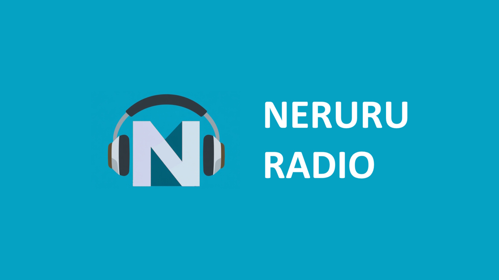

# 📻 ねるるラジオ 公式ホームページ (neruru-radio-homepage)



24時間AIによって自動生成・放送され続けるインターネットラジオステーション **「ねるるラジオ」** の公式WebサイトおよびPodcast配信リソースのリポジトリです。

---

## 📑 目次

- [概要](#-概要)
- [主な機能 & 特徴](#-主な機能--特徴)
- [タイムテーブル & 番組一覧](#-タイムテーブル--番組一覧)
- [ディレクトリ構成](#-ディレクトリ構成)
- [Podcast & RSS 配信仕様](#-podcast--rss-配信仕様)
- [フロントエンド仕様](#-フロントエンド仕様)
- [バックエンド連携アーキテクチャ](#-バックエンド連携アーキテクチャ)
- [配信URL & 関連リンク](#-配信url--関連リンク)
- [ライセンス & クレジット](#-ライセンス--クレジット)

---

## 🌐 概要

**ねるるラジオ**は、ねるる ＆ エノキ電気（ときえのき）が共同運営する、24時間365日ノンストップ配信の完全自動化AIラジオ放送局です。  
Google Geminiが番組の台本を執筆し、VOICEVOXのAI音声合成エンジンとPHP/AzuraCastのスケジューラが自動連携して番組をオンエアしています。

本リポジトリは以下の役割を持っています：

1. **公式ポータルWebサイト**: オンエア中のプレイヤー、リアルタイムタイムライン、番組情報、スポンサー情報の提供
2. **配信画面・サムネイル生成**: OBS配信やモニタ用のリアルタイム情報表示（`thumbnail.html`）
3. **Podcast / RSS配信**: 生成された各番組のmp3音声と、Apple Podcasts/Spotify等のプラットフォーム向けRSSフィード（XML）のホスティング

---

## ✨ 主な機能 & 特徴

- **リアルタイム・タイムライン表示 (`script.js`)**
  - JST（日本標準時）を自動計算し、現在時刻から直近4枠の放送予定と残り時間をカウントダウン表示。
  - 6秒ごとに自動更新され、アコーディオンで各番組のトーク内容やピックアップ情報（`/api/*.txt`）を非同期取得して表示。
- **AzuraCastプレイヤー埋め込み**
  - メインチャンネルおよびLo-Fi専用チャンネルのストリーミングプレイヤーをシームレスに埋め込み。
- **検閲フリー（ダークウェブ / Tor配信対応）**
  - 一般のWeb（クリアネット）だけでなく、Tor（Onionアドレス）経由でのアクセス・リスニングにも完全対応。
- **PWA（Progressive Web Apps）対応**
  - `manifest.json` と `sw.js` により、スマートフォンやPCでスタンドアロンアプリとしてインストール可能。
- **OBS / 配信向けオーバーレイ画面 (`thumbnail.html`)**
  - 配信サムネイルや配信用オーバーレイとして利用できる大画面用UI。ティッカースクロールフッターを搭載。

---

## 🕒 タイムテーブル & 番組一覧

本ラジオは15分単位のタイムスロットで構成されています。

| 放送時間帯         | 分           | 番組名                           | 概要                                                                                     |
| :----------------- | :----------- | :------------------------------- | :--------------------------------------------------------------------------------------- |
| **毎時**           | **00分**     | **ねるるミュージックアカデミー** | 音楽理論や打ち込み楽曲の極意を初心者向けに解説する音楽学習番組（各11分間）               |
| **05:00〜10:00**   | **15分**     | **オハラジオ**                   | さわやかな朝のスタートを応援する朝活応援番組。天気・運勢・ポジティブトーク               |
| **11:00〜23:00**   | **15分**     | **サボさんの千葉来ません？**     | 千葉を愛する「サボさん」が千葉の隠れた名所や絶品グルメを語る観光応援番組                 |
| **23:00〜翌04:00** | **15分**     | **ねるるの眠れない話**           | 眠れない夜にナビゲーター「ねるる」が心温まるエピソードや昔話を静かに語るおやすみ前トーク |
| **毎時**           | **30分**     | **ネルラジニュース**             | 1時間に1回、世の中の最新動向をコンパクトにまとめたニュース番組（各11分間）               |
| **毎時**           | **45分**     | **ガジェットマニア**             | 最新スマホ、PCパーツ、AI、プログラミングなどの情報と愛を語るテック番組（各11分間）       |
| **05:00〜23:00**   | **隙間時間** | **ときえのき製作楽曲配信**       | エノキ電気のオリジナル楽曲を中心に配信（合間に自動でスポンサーCMあり）                   |
| **23:00〜翌05:00** | **隙間時間** | **チル・ミュージック**           | 入眠に最適な著作権フリーのLo-Fiミュージック（ノンストップ・CMなし）                      |

---

## 📁 ディレクトリ構成

```text
.
├── index.html              # 公式ホームページ（メインフロントエンド）
├── thumbnail.html          # 配信サムネイル / OBS配信用リアルタイムオーバーレイ
├── script.js               # タイムライン動的生成、JST計算、API取得ロジック
├── style.css               # サイト共通スタイルシート（ダークテーマ）
├── manifest.json           # PWAマニフェスト設定
├── sw.js                   # Service Worker スクリプト
├── robots.txt              # クローラー制御設定
├── api/                    # 外部バッチから更新される番組トピック情報（JSON形式テキスト）
│   ├── 00-pickup.txt       # ねるるミュージックアカデミーのピックアップ内容
│   ├── 15-sabochiba-pickup.txt # サボさんの千葉来ません？のピックアップ内容
│   └── 45-pickup.txt       # ガジェットマニアのピックアップ内容
├── Podcasts/               # Podcast配信対象のmp3ファイル格納ディレクトリ
│   ├── gadgetmania/        # ガジェットマニアのmp3リスト
│   ├── musicacademy/       # ねるるミュージックアカデミーのmp3リスト
│   └── sabochiba/          # サボさんの千葉来ません？のmp3リスト
├── rss/                    # Podcast配信用XML（RSSフィード）格納ディレクトリ
│   ├── gadgetmania.xml     # ガジェットマニア RSSフィード
│   ├── musicacademy.xml    # ねるるミュージックアカデミー RSSフィード
│   └── sabochiba.xml       # サボさんの千葉来ません？ RSSフィード
├── assets/                 # ロゴ、背景、スポンサー紹介画像等
└── img/                    # アプリケーションアイコン、番組別サムネイル画像
    └── programs/           # 各番組のサムネイル画像一覧
```

---

## 🎙️ Podcast & RSS 配信仕様

外部のPodcastプラットフォーム（Apple Podcasts、Spotify、Amazon Music、Google等）へ配信するための音声およびRSSフィードディレクトリです。

### 1. 音声ファイル (`/Podcasts`)

外部の番組生成バッチ（Gemini + VOICEVOX）によって作成されたmp3ファイルが番組別に保管されます。

- **`/Podcasts/gadgetmania/`**: 「ガジェットマニア」の音声ファイル  
  _(命名例: `ガジェットマニア_YYYYMMDDHHMM.mp3`)_
- **`/Podcasts/musicacademy/`**: 「ねるるミュージックアカデミー」の音声ファイル  
  _(命名例: `ねるるミュージックアカデミー_YYYYMMDDHHMM.mp3`)_
- **`/Podcasts/sabochiba/`**: 「サボさんの千葉来ません？」の音声ファイル  
  _(命名例: `サボさんの千葉来ません_YYYYMMDDHHMM.mp3`)_

### 2. RSSフィード (`/rss`)

各Podcastディレクトリの最新音声を反映した以下の3つのXMLファイルが自動生成・配信されます。

| XMLファイル名      | 対象番組                     | フィードURL例                                  |
| :----------------- | :--------------------------- | :--------------------------------------------- |
| `sabochiba.xml`    | サボさんの千葉来ません？     | `https://radio.enoki.xyz/rss/sabochiba.xml`    |
| `gadgetmania.xml`  | ガジェットマニア             | `https://radio.enoki.xyz/rss/gadgetmania.xml`  |
| `musicacademy.xml` | ねるるミュージックアカデミー | `https://radio.enoki.xyz/rss/musicacademy.xml` |

> **Note**: `/Podcasts` および `/rss` 配下の動的生成ファイルは `.gitignore` に指定されており、Git管理外として運用されます。

---

## 💻 フロントエンド仕様

- **タイムライン連携 (`script.js`)**
  - 日本時間（JST: UTC+9）へのオフセット補正をクライアント側で計算。
  - 現在時刻から次回以降の4枠を判定し、15分ごとのスロットをレンダリング。
  - 「詳細」ボタン押下時に、`/api/{スロット分}-pickup.txt` からJSON配列を取得し、トークテーマを展開表示。
- **デザイン (`style.css`)**
  - GitHubライクな洗練されたダークテーマ（`#0d1117`, `#161b22`, パープルアクセント `#bb86fc`）。
  - CSS Grid / Flexboxによるレスポンシブデザイン（モバイル・タブレット・デスクトップ対応）。

---

## ⚙️ バックエンド連携アーキテクチャ

本リポジトリは、以下の外部配信システムと連携して稼働しています。

```
[ Google Gemini (LLM) ]
          │ (番組台本自動生成)
          ▼
[ VOICEVOX (AI音声合成) ]
          │ (mp3音声ファイル生成)
          ▼
[ スケジューラ & バッチスクリプト (PHP) ]
  ├── AzuraCast への自動プレイリスト投入 ───────► 24h ストリーミング配信
  ├── /api/*.txt の更新 ────────────────────────► 公式Webサイト (本リポジトリ)
  ├── /Podcasts/* へのMP3保存 ──────────────────► 本リポジトリ
  └── /rss/*.xml (Podcastフィード) の自動生成 ──► Apple / Spotify / Amazon
```

- **生成バッチシステム リポジトリ**:  
  [jikantoki/gemini-voicevox-radio](https://github.com/jikantoki/gemini-voicevox-radio)

---

## 🔗 配信URL & 関連リンク

- **公式Webサイト**: [https://radio.enoki.xyz/pages/index.html](https://radio.enoki.xyz/pages/index.html)
- **メインチャンネル配信**: [https://radio.enoki.xyz/public/neruru-radio](https://radio.enoki.xyz/public/neruru-radio)
- **Lo-Fi専用チャンネル配信**: [https://radio.enoki.xyz/public/lofi](https://radio.enoki.xyz/public/lofi)
- **ダークウェブ（Tor/Onion）配信**: `http://enoki44fwlo4num26fclh7jzuao36fkr3354g32bvkym3f472ji2dtid.onion/pages/index.html`
- **番組台本・音声自動生成システム**: [gemini-voicevox-radio (GitHub)](https://github.com/jikantoki/gemini-voicevox-radio)

---

## 👥 スポンサー & クレジット

- **エノキ電気（ときえのき）**: プログラム開発 / 作曲 / 運営
- **ねるる**: ラジオ考案 / デザイン / ナビゲーター
- **夜勤対策委員会**: 快眠推進・スポンサー
- **株式会社エンカウント**: 千葉発祥・スポンサー
- **全日本ダークウェブ普及協会**: スポンサー

---

&copy; 2026 エノキ電気 & ねるる. All Rights Reserved.
